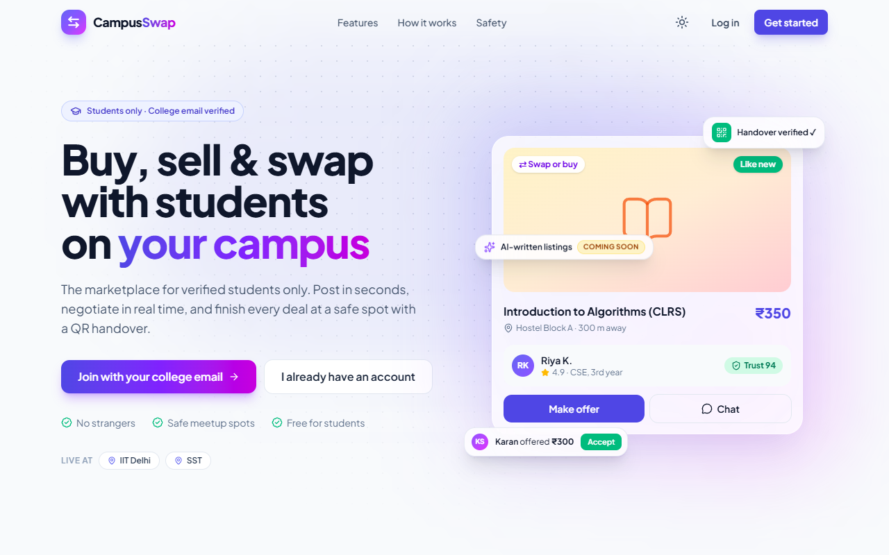
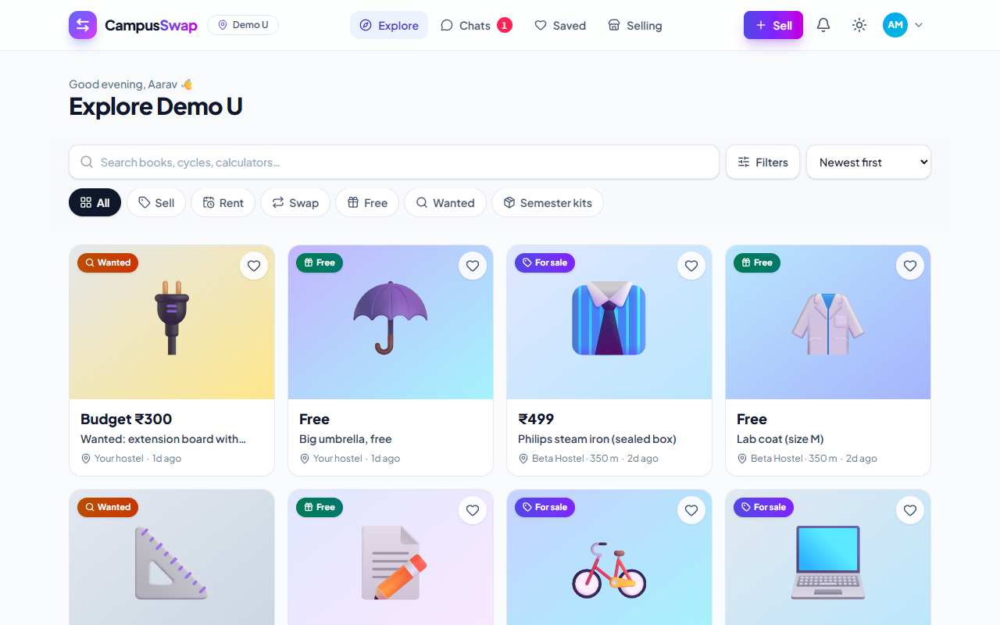
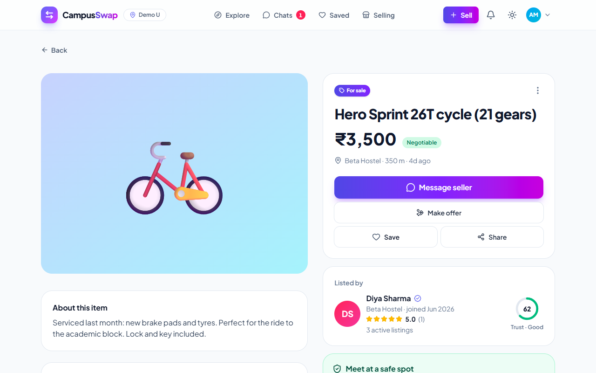
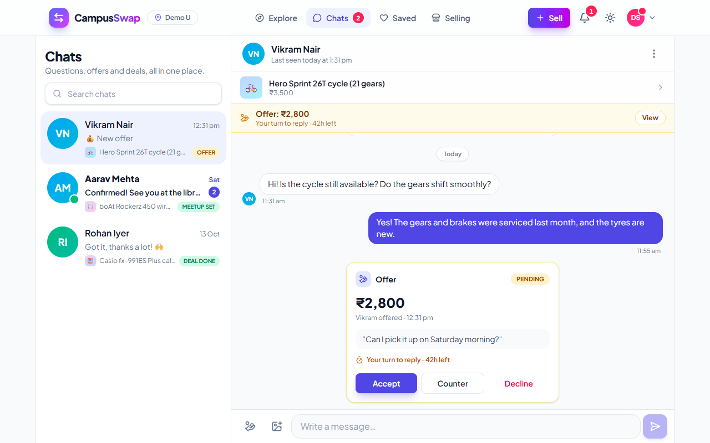
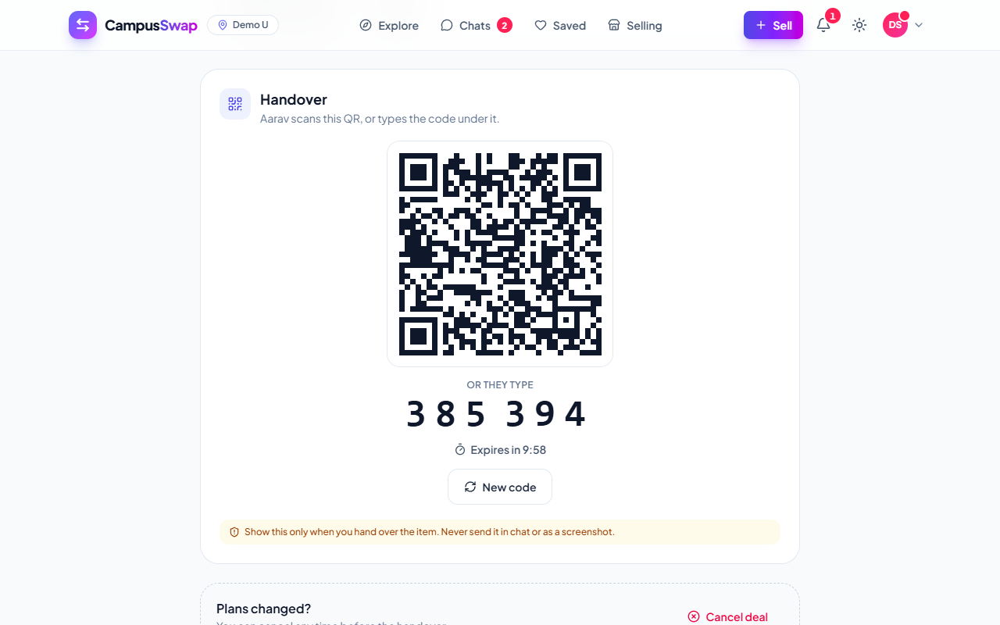
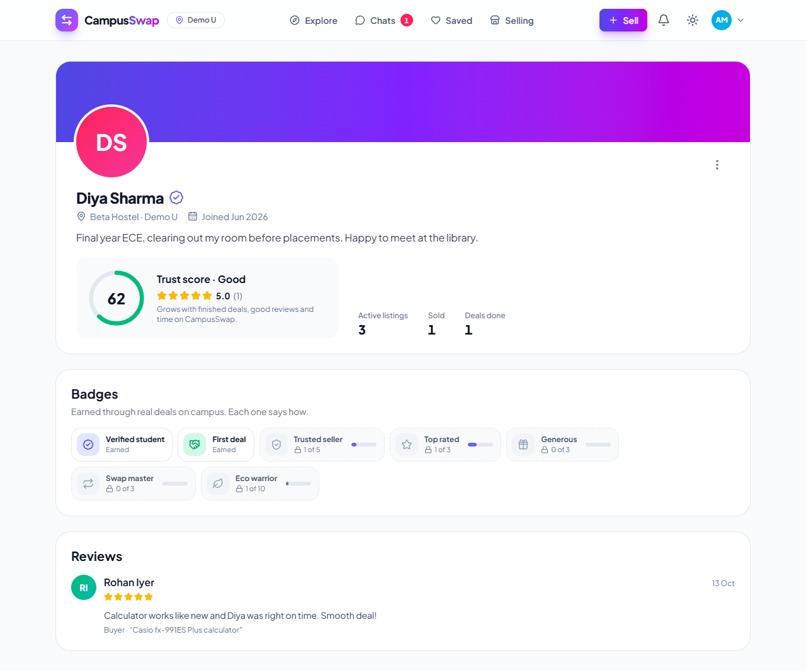
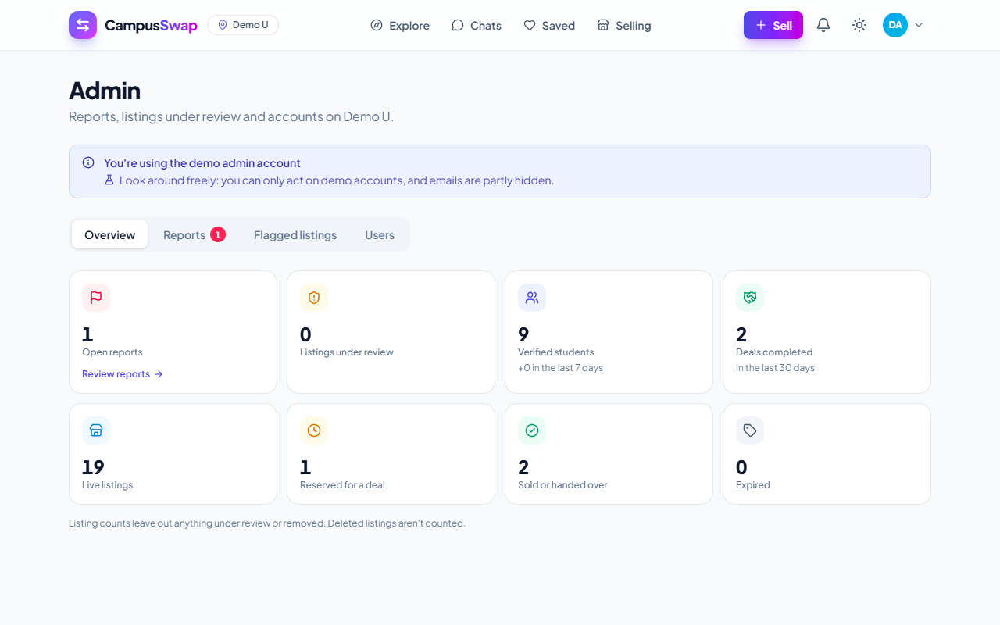
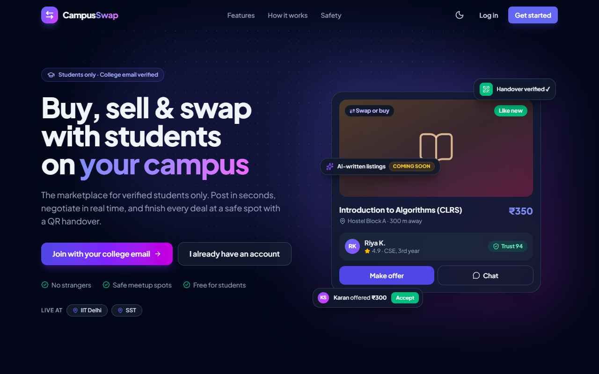
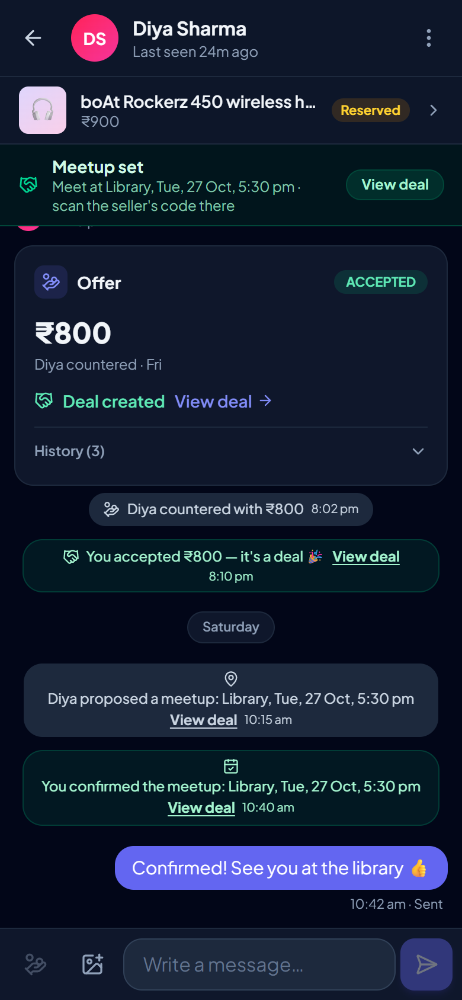
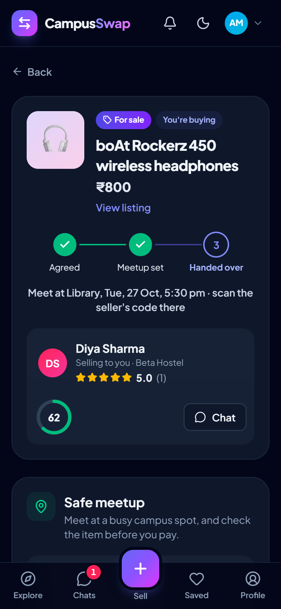

# CampusSwap

**The trusted marketplace for your campus.** Buy, sell, rent, swap or give away anything — textbooks, cycles,
lab coats, hostel gear — with verified students from your own college only. Chat in real time, agree on a price,
meet at a safe spot on campus and hand over with a QR code.

Built with the MERN stack (MongoDB, Express, React, Node.js) as a full-stack portfolio project.

**🌐 Live demo: https://campus-swap-ivory.vercel.app** — log in with `buyer@campusswap.dev` or `seller@campusswap.dev`
(password `Demo@1234`). The free server sleeps when idle, so the first load can take up to a minute.

**🎥 Demo video: https://drive.google.com/drive/folders/1X1a4pO8yWyALnRohwnJf9vhHILtrS-FA?usp=sharing** — a walkthrough of the
main flows (listing, chat and offers, QR handover, trust and admin).



## Highlights

- **Verified students only.** Sign up with your college email; the campus is detected from the domain and the
  account is confirmed with a one-time code.
- **Six ways to trade.** Sell, rent (per day/week/month), swap, give away for free, post a "wanted" request,
  or bundle a semester kit. Up to 5 photos per listing, compressed in the browser.
- **Explore your campus.** Search, filters, sorting and "nearest to my hostel" with real distances
  (MongoDB geospatial queries), infinite scroll, saved items.
- **Real-time chat.** Socket.io messaging with typing indicators, online / last seen, "Seen" receipts, photos,
  unread badges and live notifications.
- **Offers that make sense.** Make an offer, counter, accept, decline or withdraw — accepting reserves the item
  and politely closes the other negotiations.
- **Safe deals.** Every accepted offer becomes a deal: pick a campus safe spot and time (add it to your calendar),
  then hand over by scanning the seller's QR code or typing a 6-digit code. Codes are HMAC-hashed, expire in
  10 minutes and lock after 5 wrong tries.
- **Trust you can see.** Reviews after every deal, a trust score that only counts *different* people (so friends
  can't farm it), and badges like *First deal* and *Trusted seller*.
- **Safety tools.** Report listings, users or messages (listings auto-hide after reports from 3 independent,
  established accounts), block people, and an admin console for reports, flagged listings and bans — a banned
  user's open tabs are logged out instantly.
- **Polished UI.** Mobile-first, dark mode, keyboard accessible, skeleton loading states and friendly copy.

**Coming soon (after submission):** Swap Circles (3-way swaps matched automatically), AI-written listings and price
hints, eco-impact stats, a seller dashboard with charts, saved-search alerts and an installable app.

## Screenshots

| Explore | Listing | Chat + offers |
| --- | --- | --- |
|  |  |  |

| QR handover | Profile + trust | Admin console |
| --- | --- | --- |
|  |  |  |

| Dark mode | Phone: chat | Phone: deal |
| --- | --- | --- |
|  |  |  |

## Try the demo

After `npm run seed:demo` (see below) you can log in with:

| Account | Email | Password |
| --- | --- | --- |
| Buyer (Aarav) | `buyer@campusswap.dev` | `Demo@1234` |
| Seller (Diya) | `seller@campusswap.dev` | `Demo@1234` |
| Campus admin | `admin@campusswap.dev` | printed once by the seed script |

Demo accounts can't change their password, name or photo, and the demo admin only sees masked emails.

## Tech stack

| Layer | Tools |
| --- | --- |
| Frontend | React 19, Vite, Redux Toolkit + RTK Query, React Router 7, Tailwind CSS v4, Socket.io client, lucide icons, sonner |
| Backend | Node.js, Express 5, MongoDB + Mongoose, Socket.io, Zod validation, JWT in HttpOnly cookies, bcrypt |
| Files & email | Cloudinary (photos), Brevo HTTPS API or Gmail SMTP (verification codes) |
| Security | Helmet, CORS allow-list, CSRF origin guard, per-account rate limits, compression, graceful shutdown |
| Hosting | Render (API) + Vercel (web) + MongoDB Atlas |

### Engineering notes

- **No race conditions on money moments.** Accepting an offer, reserving a listing, completing a handover and
  every other state change is one conditional atomic MongoDB update; partial unique indexes guarantee one pending
  offer per chat and one open deal per listing. Two buyers accepting at the same millisecond get exactly one deal.
- **Separate token audiences.** The session cookie and the short-lived Socket.io token are signed for different
  audiences, so one can never be used as the other.
- **Private by default.** Every user lookup goes through a public projection; emails, roles and moderation data
  never reach other students.
- **Lazy expiry.** Listings and offers expire on read, so correctness never depends on a background job.

## Run it locally

You need Node.js 20+ and a MongoDB connection string (MongoDB Atlas free tier works).

```bash
# 1. Install everything (root, backend and frontend)
npm run setup

# 2. Create backend/.env from the example and fill in at least MONGO_URI and JWT_SECRET
cp backend/.env.example backend/.env

# 3. Add the campuses (safe to run again any time)
npm run seed

# 4. Optional: demo accounts, listings, chats and deals (prints the logins)
npm run seed:demo

# 5. Start the API (port 8084) and the web app (port 5173) together
npm run dev
```

Open http://localhost:5173. Without email settings, verification codes are printed in the backend terminal, so you
can sign up with any seeded campus email such as `you@campusswap.dev` (the demo campus). Without Cloudinary keys,
photos are saved in `backend/uploads` (development only).

## Useful scripts

| Command | What it does |
| --- | --- |
| `npm run dev` | Starts the backend and frontend together |
| `npm run seed` | Creates or updates campuses and backfills defaults |
| `npm run seed:demo` | Adds the demo data (`npm run seed:demo -- --reset` wipes and recreates it; only demo accounts are touched) |
| `npm run make-admin -- you@college.edu` | Makes an account an admin of its campus (`--global` for every campus) |
| `npm run build` | Builds the frontend for production |

## Deploy (free tiers)

1. **MongoDB Atlas:** Network Access → allow `0.0.0.0/0` (Render's outgoing IPs change).
2. **Render (API):** New → Blueprint → pick this repo; `render.yaml` sets everything up. Fill in the secret values it
   asks for: `MONGO_URI`, `CLIENT_URL` (your exact Vercel URL), `EMAIL_FROM` + `BREVO_API_KEY` (Render's free plan
   blocks SMTP, so use Brevo), and the three `CLOUDINARY_*` keys. `JWT_SECRET` is generated for you.
3. **Vercel (web):** in `frontend/vercel.json`, replace `<your-render-app>` with your Render service name. Then import
   the repo on Vercel with **Root Directory = `frontend`** and add the environment variable `VITE_SOCKET_URL` = your
   Render URL (Vercel can't proxy WebSockets). Deploy.
4. Put the final Vercel URL in Render's `CLIENT_URL` and redeploy the API.
5. From your machine (with `MONGO_URI` pointing at Atlas): `npm run seed`, then `npm run seed:demo`, then
   `npm run make-admin -- you@college.edu`.

Render's free instance sleeps after 15 minutes without traffic, so the first request after a break can take
30–60 seconds.

## Project structure

```
backend/
  config/        env validation (Zod) and constants
  controllers/   route handlers
  middlewares/   auth, validation, rate limits, origin guard, uploads, errors
  models/        Mongoose schemas (users, listings, chats, offers, deals, reviews, reports, …)
  routes/        Express routers mounted under /api
  socket/        Socket.io server (auth, presence, typing)
  utils/         business logic (offers, deals, trust, reports, blocks, email, storage, …)
  scripts/       seed, seed:demo, make-admin
frontend/
  src/api/       RTK Query endpoints
  src/components/ UI kit, listings, chat, deals, trust, admin
  src/pages/     routes (lazy-loaded)
  src/socket/    Socket.io client + cache updates
render.yaml      Render blueprint · frontend/vercel.json  Vercel config
```
